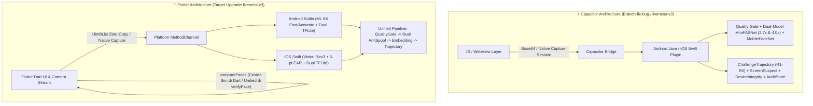
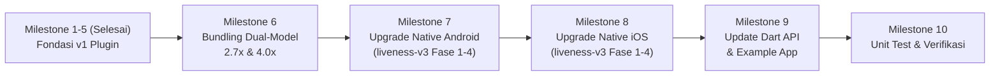

# 📋 Rencana Migrasi: Face Recognition & Enterprise Liveness (`liveness-v3`) ke Flutter Plugin

Dokumen ini berisi rencana arsitektur dan langkah eksekusi migrasi **`capacitor-face-recognition-tflite` (branch `fix-bug` / `liveness-v3`)** menjadi plugin Flutter: **`flutter_face_recognition`** lengkap dengan aplikasi percontohan (*example app*).

---

## 1. Perbandingan Arsitektur: Capacitor (`fix-bug`) vs Flutter (`liveness-v3`)



### Keunggulan Arsitektur Baru (`liveness-v3` di Flutter):
1. **True Dual-Model Silent-Face Ensemble (`2.7x` + `4.0x`)**: Menggantikan pendekatan model tunggal lama (`[1.0x, 2.7x]`) dengan duet model resmi **`anti_spoof_2_7.tflite`** (MiniFASNetV2, scale `2.7`) dan **`anti_spoof_4_0.tflite`** (MiniFASNetV1SE, scale `4.0`) serta algoritma crop [`getNewBox`](file:///Users/andrewhardianto/Documents/andrewzone/Project/plugin/capacitor-face-recognition/android/src/main/java/com/andrew/face/FaceRecognitionPlugin.java#L1529-L1562) (`_get_new_box`) yang menggeser kotak (*shift*) tanpa memotong rasio konteks.
2. **Zero-Copy Memory (`Uint8List`) & Native Capture**: Mendukung pengiriman bytes langsung (`Uint8List`) dari Dart tanpa overhead encoding Base64, serta menyediakan sesi tangkapan kamera native (`captureLivenessSession`) yang tahan terhadap injeksi frame.
3. **Anti-TOCTOU (`verifyFace`)**: Menyatukan *Quality Gate*, *Dual-Model Anti-Spoofing*, dan *Face Embedding* dalam satu pemanggilan atomik pada frame dan *bounding box* wajah yang sama.
4. **Single-Source Asset Bundling**: Ketiga model `.tflite` (`mobile_face_net.tflite`, `anti_spoof_2_7.tflite`, `anti_spoof_4_0.tflite`) disimpan di satu lokasi (`assets/models/`) dan dimuat langsung oleh Android & iOS via Flutter Asset Lookup API.
5. **Perbaikan Temuan Senior SDK Review**:
   - Menangani *thread-safety* (`NSLock`) pada *rate limiter* di iOS.
   - Menambahkan `.recycle()` pada *intermediate Bitmap* di `varianceOfLaplacian` dan `meanLuminance` Android untuk mencegah *GC thrashing*.
   - Menyesuaikan opsi `minLiveVoteRatio` pada sesi challenge agar tahan terhadap penurunan skor liveness alami saat wajah menoleh $\ge 15^\circ$, sambil tetap mempertahankan *hard veto* (`SPOOF_HARD_VETO = 0.50`).

---

## 2. Struktur Proyek (`flutter_face_recognition` — `liveness-v3`)

```text
flutter_face_recognition/
├── assets/models/                           # Single-source model TFLite
│   ├── mobile_face_net.tflite              # ~5.0 MB (Face Recognition 192-dim)
│   ├── anti_spoof_2_7.tflite               # ~1.8 MB (MiniFASNet scale 2.7x, 80x80 BGR)
│   ├── anti_spoof_4_0.tflite               # ~1.8 MB (MiniFASNet scale 4.0x, 80x80 BGR)
│   └── anti_spoof.tflite                   # Fallback kompatibilitas legacy (2.7x)
├── android/
│   ├── build.gradle.kts                    # ML Kit, TFLite & Coroutines dependencies
│   └── src/main/kotlin/com/andrew/face/
│       ├── FlutterFaceRecognitionPlugin.kt # MethodCallHandler + Core Pipeline (Fase 1-4)
│       ├── YawConvention.kt                # Normalisasi yaw anatomis lintas platform
│       ├── ChallengeTrajectory.kt          # Evaluator lintasan 5 aturan (R1-R5) + median3
│       ├── ScreenSuspect.kt                # Detektor artefak Moiré / bezel layar 32x32
│       ├── DeviceIntegrity.kt              # Deteksi Root, Emulator, Debuggable, Frida/Xposed
│       ├── AuditStore.kt                   # Penyimpanan jejak audit terenkripsi (AES-GCM)
│       └── LivenessCaptureActivity.kt      # Native CameraX UI untuk captureLivenessSession
├── ios/
│   ├── flutter_face_recognition.podspec    # TensorFlowLiteSwift dependency
│   └── Classes/
│       ├── FlutterFaceRecognitionPlugin.swift # MethodCallHandler + Vision Rev3 + TFLite
│       ├── YawConvention.swift             # Normalisasi yaw anatomis iOS Vision
│       ├── ChallengeTrajectory.swift       # Evaluator lintasan 5 aturan (R1-R5)
│       ├── ScreenSuspect.swift             # Detektor artefak layar
│       ├── DeviceIntegrity.swift           # Deteksi Jailbreak, Simulator, Debugger, Hooks
│       ├── AuditStore.swift                # Penyimpanan audit terenkripsi iOS
│       └── LivenessCaptureViewController.swift # Native AVFoundation UI untuk captureLivenessSession
├── lib/
│   ├── flutter_face_recognition.dart       # Public API (Fase 1-4)
│   └── src/
│       └── models.dart                     # Typed Models: GateConfig, QualityResult, LivenessResult,
│                                           # VerifyFaceResult, SequenceVerifyResult, DeviceIntegrityResult
└── example/                                # Aplikasi demonstrasi lengkap
    ├── lib/
    │   ├── main.dart                       # Demo UI: Enroll, VerifyFace, Active Challenge, Kalibrasi Yaw
    │   └── camera_view.dart                # Live Camera Overlay & Detection
    └── pubspec.yaml
```

---

## 3. Spesifikasi 4 Fase Pertahanan Berlapis (*Defense-in-Depth*)

### Fase 1 & 2: Dual-Model Anti-Spoofing, Detektor Akurat, & Quality Gate

#### 1. Dual-Model Silent-Face Anti-Spoofing (`runAntiSpoof` / `checkLiveness`)
* **Model & Skala Crop**:
  - `anti_spoof_2_7.tflite` dipasangkan dengan [`CROP_SCALE_27 = 2.7f`](file:///Users/andrewhardianto/Documents/andrewzone/Project/plugin/capacitor-face-recognition/android/src/main/java/com/andrew/face/FaceRecognitionPlugin.java#L72).
  - `anti_spoof_4_0.tflite` dipasangkan dengan [`CROP_SCALE_40 = 4.0f`](file:///Users/andrewhardianto/Documents/andrewzone/Project/plugin/capacitor-face-recognition/android/src/main/java/com/andrew/face/FaceRecognitionPlugin.java#L73).
  - Fallback ke `anti_spoof.tflite` jika hanya model *legacy* yang tersedia (`degradedSingleModel = true`).
* **Algoritma Crop [`getNewBox`](file:///Users/andrewhardianto/Documents/andrewzone/Project/plugin/capacitor-face-recognition/android/src/main/java/com/andrew/face/FaceRecognitionPlugin.java#L1529-L1562)**:
  - Menghitung `s = min(scale, min((imgW - 1) / boxW, (imgH - 1) / boxH))`.
  - Lebar dan tinggi baru dihitung terpisah (`newW = boxW * s`, `newH = boxH * s`) dari titik tengah wajah, lalu **digeser (*shift*)** jika melewati batas kiri/atas/kanan/bawah gambar.
  - Di-resize ke **$80 \times 80$** dengan format piksel **BGR raw `[0..255]`** (`FLOAT32`).
* **Aturan Keputusan Ensemble (`THRESHOLD_VERSION = "liveness-v3"`)**:
  - $\mathbf{p} = \text{softmax}(\mathbf{z}_{2.7}) + \text{softmax}(\mathbf{z}_{4.0})$ (rentang $0..2$).
  - `printScore = p[0] / 2`, `liveScore = p[1] / 2`, `replayScore = p[2] / 2`, `spoofScore = max(p[0], p[2]) / 2`.
  - `label = argmax(p)` (`0 -> PRINT`, `1 -> LIVE`, `2 -> REPLAY`).
  - `isLive = (label == "LIVE") && (liveScore >= liveThreshold) && (spoofScore < spoofVeto)` dengan default `liveThreshold = 0.80` dan `spoofVeto = 0.20`.

#### 2. Deteksi Wajah (`detectFaces` & `livenessDetector`)
* **Android**:
  - `faceDetector` (`PERFORMANCE_MODE_FAST`, `LANDMARK_MODE_ALL`, `CLASSIFICATION_MODE_ALL`) untuk `detectFaces` *real-time*.
  - `livenessDetector` (`PERFORMANCE_MODE_ACCURATE`, `CLASSIFICATION_MODE_ALL`) khusus untuk `checkLiveness`, `verifyFace`, dan `verifyFaceSequence`.
  - Selalu memilih wajah utama menggunakan [`pickLargestFace`](file:///Users/andrewhardianto/Documents/andrewzone/Project/plugin/capacitor-face-recognition/android/src/main/java/com/andrew/face/FaceRecognitionPlugin.java#L1568-L1580) (luas `width * height` terbesar), bukan indeks ke-0.
* **iOS**:
  - Mengunci request ke **`VNDetectFaceRectanglesRequestRevision3`** agar memperoleh nilai `yaw`, `pitch`, dan `roll` kontinu dalam radian (dikonversi ke derajat).
  - Menghitung `leftEyeOpenProbability` & `rightEyeOpenProbability` dengan rumus **Euclidean 6-titik EAR**:
    $$\text{EAR} = \frac{\|p_1 - p_5\| + \|p_2 - p_4\|}{2 \cdot \|p_3 - p_0\|}$$
    yang dinormalisasi dengan `/ 0.3` dan di-*clamp* ke $[0.0, 1.0]$.
* **Konvensi Sudut Kepala ([`YawConvention`](file:///Users/andrewhardianto/Documents/andrewzone/Project/plugin/capacitor-face-recognition/android/src/main/java/com/andrew/face/YawConvention.java))**:
  - `yaw` dinormalisasi di sumber pengukuran sehingga **positif = user menoleh ke KANAN anatomisnya**, **negatif = user menoleh ke KIRI anatomisnya** baik di Android maupun iOS.

#### 3. Pre-Liveness Quality Gate ([`runQualityGate`](file:///Users/andrewhardianto/Documents/andrewzone/Project/plugin/capacitor-face-recognition/android/src/main/java/com/andrew/face/FaceRecognitionPlugin.java#L1333-L1403))
Memvalidasi kualitas frame dengan urutan deterministik sebelum inferensi TFLite:
1. `NO_FACE`: Tidak ada wajah terdeteksi.
2. `MULTIPLE_FACES`: Terdapat wajah kedua dengan luas $\ge 30\%$ dari wajah terbesar.
3. `LOW_RESOLUTION`: $\min(\text{width}, \text{height}) < 480\text{px}$.
4. `FACE_TOO_SMALL`: $\text{faceWidth} / \text{frameWidth} < 0.25$.
5. `FACE_AT_EDGE`: Jarak tepi wajah ke pinggir gambar $< 5\%$ dimensi frame.
6. `BAD_POSE`: $|\text{yaw}| > 20^\circ$, $|\text{pitch}| > 20^\circ$, atau $|\text{roll}| > 20^\circ$.
7. `BLURRY`: **Variance of Laplacian** (kernel $3\times3$ pada crop grayscale $160\times160$) $< 50.0$.
8. `BAD_LIGHTING`: **Mean Luminance** (pada crop $64\times64$) di luar rentang $[60.0, 200.0]$.

---

### Fase 3: Penutupan TOCTOU (`verifyFace`) & Active Temporal Challenge (`verifyFaceSequence`)

#### 1. Unified `verifyFace` (Anti-TOCTOU)
* Menjalankan **Quality Gate $\to$ Dual-Model Anti-Spoofing $\to$ MobileFaceNet Embedding ($112\times112$, 192-dim L2-normalized)** pada **1 frame dan 1 bounding box yang sama**.
* `embedding` (dan hasil `match` opsional bila diberikan `referenceEmbedding`) **hanya dikembalikan jika `quality.passed == true` dan `liveness.isLive == true`**.

#### 2. Single-Use Challenge Session (`createChallengeSession`)
* Menghasilkan sesi challenge di sisi native (`sessionId` UUID, `challenge` acak `LOOK_LEFT` atau `LOOK_RIGHT`, `expiresAt` TTL 60 detik).
* Sesi langsung dihapus saat pertama kali dipakai (`consumeChallengeSession`) sehingga tidak bisa di-*replay* atau dipilih arahnya dari sisi klien.

#### 3. Evaluasi Lintasan Temporal ([`ChallengeTrajectory`](file:///Users/andrewhardianto/Documents/andrewzone/Project/plugin/capacitor-face-recognition/android/src/main/java/com/andrew/face/ChallengeTrajectory.java))
Mengevaluasi deret frame (minimal 5 frame lolos quality gate, dengan $\ge 70\%$ dari total frame lolos quality gate) menggunakan 5 aturan lintasan:
* **R1 (`frontalStart`)**: 2 frame awal wajib menghadap depan ($|\text{yaw}| < 8^\circ$).
* **R2 (`deviation`)**: Mencapai deviasi $\ge 15^\circ$ ke arah challenge setelah fase R1.
* **R3 (`returnFrontal`)**: 2 frame terakhir kembali menghadap depan ($|\text{yaw}| < 12^\circ$, gagal $\to$ `CHALLENGE_NO_RETURN`).
* **R4 (`singleDirection`)**: Deviasi ke arah yang salah pada sinyal terfilter *median-3* $< 12^\circ$ (gagal $\to$ `CHALLENGE_WRONG_DIRECTION`).
* **R5 (`smoothMotion`)**: Terdapat minimal 3 delta berturut-turut searah ($\ge 1^\circ/\text{frame}$) pada sinyal terfilter *median-3*, serta menghitung `deltaVariance` untuk mendeteksi lintasan video sintetis yang terlalu seragam (`tooSmooth` jika `deltaVariance < 0.05`).

#### 4. Pose-Aware Identity Consistency
* Hanya membandingkan *cosine similarity* pada frame yang mendekati frontal ($|\text{yaw}| \le 12^\circ$, minimal 2 frame) terhadap **frame paling frontal** ($\min |\text{yaw}|$).
* Syarat lulus: `minIdentityCosine >= 0.55` dan `avgCosine >= identityThreshold` (default `0.70`).
* Embedding yang dikembalikan dari sesi adalah embedding milik frame paling frontal.

---

### Fase 4: Anti-Frame-Injection, Anti-Replay, Device Integrity, & Audit Store

1. **Native Camera Capture (`captureLivenessSession`) & Proteksi Jalur Frame**:
   - Di build rilis (*non-debuggable*), pemanggilan `verifyFaceSequence` dari layer Dart/JS diblokir (`INSECURE_FRAME_PATH_DISABLED`) kecuali `enableInsecureFramePath: true` diaktifkan saat `initialize`.
   - `captureLivenessSession` membuka kamera native (`LivenessCaptureActivity` / `LivenessCaptureViewController`), menampilkan instruksi arah challenge, menunggu *warmup* `1200ms`, lalu menangkap 12 frame berinterval `120ms` ke direktori cache privat dan langsung mengevaluasinya di memori native.
2. **Hard Spoof Veto & Anti-Replay Signals**:
   - **Zero-Tolerance Spoof Veto**: Jika **1 frame saja** dalam sesi memiliki `label != "LIVE"` atau `spoofScore >= 0.50` (`SPOOF_HARD_VETO`), seluruh sesi langsung ditolak dengan `SPOOF_FRAME_DETECTED`.
   - **Screen Suspect (`ScreenSuspect`)**: Menganalisis artefak Moiré / ketidakselarasan kanal warna pada grid $32\times32$ untuk menghasilkan `screenSuspectScore` (dengan veto opsional `screenSuspectVeto`).
   - **Session Timing Gate**: Menolak sesi jika durasi total frame di luar rentang `1000ms` – `5000ms` (`TIMING_SUSPECT`).
3. **Rate Limiting, Device Integrity, & Audit Store**:
   - **Rate Limiter**: Maksimal 10 percobaan sesi per jendela 5 menit (`RATE_LIMITED`).
   - **Device Integrity (`getDeviceIntegrity`)**: Memeriksa `isEmulator`, `isRooted` (su binary, Magisk, Cydia/Sileo), `isDebuggable`, dan `hooksDetected` (Frida, Xposed, Substrate).
   - **Encrypted Audit Store (`AuditStore`)**: Menyimpan metadata evaluasi dan sampel frame secara terenkripsi di penyimpanan privat aplikasi serta mengembalikan `auditId`.

---

## 4. Tahapan & Milestone Pengerjaan



### Milestone 1–5: Fondasi Awal Plugin (`v1` — Selesai)
- [x] Scaffold plugin Flutter (`android`, `ios`, `lib`, `example`, `test`).
- [x] Pipeline dasar `detectFaces`, `extractFaceFeature`, `checkLiveness` (single-model), `compareFaces`, dan `dispose`.

### Milestone 6: Pembaruan Aset Model Dual-Scale (`liveness-v3`)
- [ ] Salin `anti_spoof_2_7.tflite` dan `anti_spoof_4_0.tflite` dari `capacitor-face-recognition` (branch `fix-bug`) ke `assets/models/`.
- [ ] Daftarkan kedua model baru di `pubspec.yaml` (tetap pertahankan `anti_spoof.tflite` sebagai *fallback* kompatibilitas).

### Milestone 7: Upgrade Native Android ke `liveness-v3` (`Kotlin`)
- [ ] Porting modul murni: `YawConvention.kt`, `ChallengeTrajectory.kt`, `ScreenSuspect.kt`, `DeviceIntegrity.kt`, dan `AuditStore.kt`.
- [ ] Upgrade [`FlutterFaceRecognitionPlugin.kt`](file:///Users/andrewhardianto/Documents/andrewzone/Project/plugin/flutter_face_recognition/android/src/main/kotlin/com/andrew/face/FlutterFaceRecognitionPlugin.kt):
  - Muat duet interpreter `antiSpoof27Interpreter` (`2.7x`) & `antiSpoof40Interpreter` (`4.0x`).
  - Pisahkan `faceDetector` (`FAST`) dan `livenessDetector` (`ACCURATE`) + gunakan `pickLargestFace`.
  - Implementasikan `getNewBox` (*boundary-shifting crop*), ensemble softmax + `spoofVeto`, dan `runQualityGate` (dengan `.recycle()` pada bitmap kerja `varianceOfLaplacian` & `meanLuminance`).
  - Tambahkan method `verifyFace`, `createChallengeSession`, `verifyFaceSequence`, `captureLivenessSession` (beserta `LivenessCaptureActivity`), dan `getDeviceIntegrity`.

### Milestone 8: Upgrade Native iOS ke `liveness-v3` (`Swift`)
- [ ] Porting modul pendukung: `YawConvention.swift`, `ChallengeTrajectory.swift`, `ScreenSuspect.swift`, `DeviceIntegrity.swift`, `AuditStore.swift`, dan `LivenessCaptureViewController.swift`.
- [ ] Upgrade [`FlutterFaceRecognitionPlugin.swift`](file:///Users/andrewhardianto/Documents/andrewzone/Project/plugin/flutter_face_recognition/ios/Classes/FlutterFaceRecognitionPlugin.swift):
  - Kunci Vision ke `VNDetectFaceRectanglesRequestRevision3` dan gunakan 6-point Euclidean EAR.
  - Muat duet interpreter `antiSpoof27Interpreter` & `antiSpoof40Interpreter` + algoritma crop `getNewBox`.
  - Implementasikan `runQualityGate`, `verifyFace`, `createChallengeSession`, `verifyFaceSequence`, `captureLivenessSession`, dan `getDeviceIntegrity` (dengan `NSLock` pada `sessionAttempts` rate limiter).

### Milestone 9: Pembaruan Layer Dart API & Example App
- [ ] Perbarui [`models.dart`](file:///Users/andrewhardianto/Documents/andrewzone/Project/plugin/flutter_face_recognition/lib/src/models.dart) dan [`flutter_face_recognition.dart`](file:///Users/andrewhardianto/Documents/andrewzone/Project/plugin/flutter_face_recognition/lib/flutter_face_recognition.dart):
  - Tambahkan model `GateConfig`, `QualityResult`, `VerifyFaceResult`, `ChallengeSession`, `TrajectoryResult`, `SequenceVerifyResult`, dan `DeviceIntegrityResult`.
  - Perbarui `LivenessResult` agar memuat `liveScore`, `printScore`, `replayScore`, `spoofScore`, `label` (`LIVE` / `PRINT` / `REPLAY`), `quality`, dan `thresholdVersion` (`liveness-v3`).
- [ ] Perbarui [`example/lib/main.dart`](file:///Users/andrewhardianto/Documents/andrewzone/Project/plugin/flutter_face_recognition/example/lib/main.dart) untuk mendemonstrasikan `verifyFace`, Active Challenge (`LOOK_LEFT` / `LOOK_RIGHT`), diagnostik Quality Gate, dan rincian skor `live` vs `print` vs `replay`.

### Milestone 10: Pengujian & Validasi Kualitas
- [ ] Tambahkan unit test Dart untuk model & serialisasi API `liveness-v3` di [`test/flutter_face_recognition_test.dart`](file:///Users/andrewhardianto/Documents/andrewzone/Project/plugin/flutter_face_recognition/test/flutter_face_recognition_test.dart).
- [ ] Jalankan `flutter analyze` dan `flutter test` hingga bersih 0 isu.

---

## 5. Matriks Mitigasi Teknis (`liveness-v3`)

| Risiko / Masalah Teknis | Solusi Arsitektur di `flutter_face_recognition` |
|---|---|
| **Skor liveness wajah asli rendah (28% / 8%) pada model tunggal** | Menggunakan **duet 2 model berbeda** (`anti_spoof_2_7.tflite` pada skala `2.7x` + `anti_spoof_4_0.tflite` pada skala `4.0x`), menghapus skala `1.0x`, dan memakai `getNewBox` (*shifting crop*). |
| **Celah keamanan TOCTOU antara `checkLiveness` & `extractFaceFeature`** | Menyediakan method terpadu `verifyFace` yang mengeksekusi Quality Gate, Anti-Spoof, dan ekstraksi Embedding pada 1 frame & 1 bounding box yang sama. |
| **Spoof lolos karena rata-rata multi-frame (Video Replay)** | Menerapkan **Zero-Tolerance Hard Spoof Veto** (`SPOOF_HARD_VETO = 0.50`): 1 frame terdeteksi spoof langsung menggagalkan seluruh sesi (`SPOOF_FRAME_DETECTED`). |
| **User asli gagal challenge saat menoleh $\ge 15^\circ$ (BPCER tinggi)** | Memisahkan *hard spoof veto* dari `minLiveVoteRatio` (dapat dikonfigurasi, rekomendasi `0.80`) dan mengecualikan frame $|\text{yaw}| > 12^\circ$ dari pengecekan konsistensi identitas MobileFaceNet. |
| **Perbedaan tanda sudut Yaw antara Android ML Kit, iOS Vision, & ROM kamera flip** | Menormalisasi yaw lewat `YawConvention` (positif = kanan anatomis user) + menyediakan `GateConfig.yawSignOverride` (`1` atau `-1`). |
| **iOS Vision mengembalikan sudut kepala diskrit ($\pm 45^\circ$)** | Mengunci request ke `VNDetectFaceRectanglesRequestRevision3` yang menghasilkan sudut yaw, pitch, dan roll kontinu. |
| **Injeksi frame Base64 palsu melalui layer UI/JS** | Memblokir jalur frame eksternal di build rilis (`INSECURE_FRAME_PATH_DISABLED`) secara default dan menyediakan `captureLivenessSession` berbasis kamera native. |
| **Tekanan GC & Thread Race pada sesi 12 frame** | Me-recycle *intermediate Bitmap* pada kalkulasi Laplacian/Luminance di Android dan melindungi *rate limiter* `sessionAttempts` dengan `NSLock` di iOS. |
