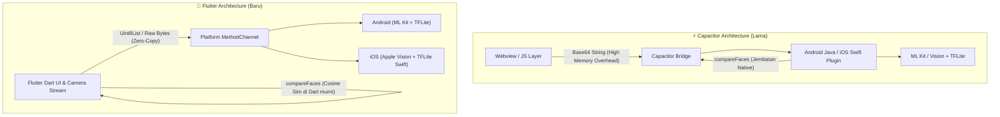
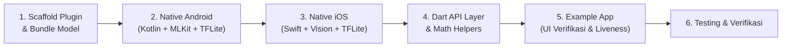

# 📋 Rencana Migrasi: Face Recognition & Anti-Spoofing ke Flutter Plugin

Dokumen ini berisi rencana arsitektur dan langkah eksekusi pembuatan ulang proyek **`capacitor-face-recognition-tflite`** menjadi plugin resmi Flutter: **`flutter_face_recognition`** lengkap dengan aplikasi percontohan (*example app*).

---

## 1. Perbandingan Arsitektur: Capacitor vs Flutter



### Keuntungan Arsitektur Flutter:
1. **Efisiensi Memori (Zero-Copy Bytes)**: Menghindari encoding/decoding Base64 yang memakan RAM besar dan membebani garbage collection.
2. **Perhitungan Matematika di Dart**: `compareFaces` (Cosine Similarity) dihitung langsung di Dart murni secara instan (<0.1 ms), tanpa perlu melewati *platform channel*.
3. **Dukungan Multi-Input**: Menerima input berupa `Uint8List` (encoded JPEG/PNG bytes), `Base64` (untuk backward compatibility), serta dukungan opsional raw frame kamera (`YUV420` / `BGRA8888`) untuk *real-time stream*.
4. **Single-Source Asset Bundling**: Model `.tflite` cukup disimpan di satu lokasi (`assets/models/` pada paket Flutter) dan dimuat oleh Android & iOS secara langsung via Flutter Asset Lookup API, mencegah ukuran aplikasi membengkak 3x lipat.
5. **Non-Blocking Background Inference**: Seluruh decoding gambar, deteksi wajah, dan inferensi TFLite dijalankan di *background thread* (`Dispatchers.Default` di Android & `DispatchQueue.global` di iOS) sehingga UI Flutter tetap berjalan mulus 60/120 FPS.

---

## 2. Struktur Proyek (`flutter_face_recognition`)

Proyek dirancang sebagai **Plugin Reusable** yang siap di-publish ke pub.dev atau digunakan sebagai modul lokal:

```
flutter_face_recognition/
├── assets/models/                     # Single-source model TFLite (~10.7 MB total)
│   ├── mobile_face_net.tflite        # ~5.0 MB (Face Recognition 192-dim)
│   └── anti_spoof.tflite             # ~5.7 MB (MiniFASNet Liveness)
├── android/
│   ├── build.gradle.kts              # ML Kit, TFLite & Coroutines dependencies
│   └── src/main/
│       └── kotlin/.../
│           └── FlutterFaceRecognitionPlugin.kt # MethodCallHandler + FlutterLoader Asset
├── ios/
│   ├── flutter_face_recognition.podspec # TensorFlowLiteSwift dependency
│   └── Classes/ (atau Sources/)
│       └── FlutterFaceRecognitionPlugin.swift # MethodCallHandler + Vision + lookupKey
├── lib/
│   ├── flutter_face_recognition.dart           # Public API & Entity Models
│   ├── flutter_face_recognition_platform_interface.dart
│   └── flutter_face_recognition_method_channel.dart
└── example/                          # Aplikasi demonstrasi lengkap
    ├── lib/
    │   ├── main.dart                 # Demo UI: Enroll, Verify, Liveness Check
    │   └── camera_view.dart          # Live Camera Overlay & Detection
    └── pubspec.yaml
```

---

## 3. Komponen Inti yang Dimigrasi

### 1. `detectFaces` (Deteksi Wajah & Koordinat)
* **Android**: Google ML Kit `FaceDetection` dengan `CLASSIFICATION_MODE_ALL` dan `LANDMARK_MODE_ALL`.
* **iOS**: Apple Vision `VNDetectFaceLandmarksRequest` dengan estimasi *Eye Aspect Ratio* (EAR) untuk deteksi mata berkedip.
  - **Normalisasi EAR ke Probabilitas $[0.0, 1.0]$**: Nilai mentah EAR (umumnya $\approx 0.15$ saat tertutup hingga $\approx 0.35$ saat terbuka) dipetakan dan di-*clamp* ke rentang $[0.0, 1.0]$ di Swift agar skala `leftEyeOpenProbability` dan `rightEyeOpenProbability` konsisten dengan output ML Kit di Android.
* **Output**:
  - `count`: Jumlah wajah terdeteksi.
  - `faces`: List koordinat (`x`, `y`, `width`, `height`), sudut rotasi kepala (`headEulerAngleY`, `headEulerAngleZ`), dan probabilitas buka mata (`leftEyeOpenProbability`, `rightEyeOpenProbability` dalam rentang $0.0 - 1.0$).

### 2. `extractFaceFeature` (Ekstraksi Embedding Wajah)
* **Pipeline Preprocessing**:
  1. Deteksi wajah pertama via ML Kit / Apple Vision.
  2. Bounding box clamping (mencegah overflow koordinat gambar).
  3. Crop area wajah $\to$ resize ke **$112 \times 112$**.
  4. Normalisasi pixel RGB ke rentang $[-1.0, 1.0]$: $\text{val} = \frac{\text{pixel}}{128.0} - 1.0$.
* **Inference & Post-Processing**:
  1. Model `mobile_face_net.tflite` menghasilkan Float array 192 dimensi.
  2. **L2-Normalization**: Vektor embedding dinormalisasi terlebih dahulu ($\hat{\mathbf{v}} = \frac{\mathbf{v}}{\|\mathbf{v}\|_2}$) agar skala embedding seragam dan perhitungan Cosine Similarity lebih stabil.

### 3. `checkLiveness` (Anti-Spoofing / Passive Liveness)
* **Pipeline Multi-Scale MiniFASNet**:
  1. Deteksi wajah $\to$ ubah bounding box menjadi bujur sangkar (*square*).
  2. **Multi-Scale Crop**:
     - **Scale 1.0x**: Crop ketat (area wajah inti).
     - **Scale 2.7x**: Crop lebar (menangkap artefak layar HP / pinggiran kertas foto cetak).
  3. Resize masing-masing ke **$80 \times 80$**.
  4. Format pixel: **BGR raw [0, 255]** (sesuai pre-baked normalisasi MiniFASNet).
  5. Inference `anti_spoof.tflite` $\to$ output 3 logits `[print_spoof, real_face, replay_spoof]`.
  6. Hitung **Softmax** pada output logits $\to$ ambil probabilitas Index 1 (`real_face`).
  7. Rata-ratakan skor dari kedua scale $\to$ bandingkan dengan threshold ($0.75$).

### 4. `compareFaces` (Verifikasi Wajah)
* Dijalankan di layer **Dart** murni tanpa overhead pemanggilan bridge:
  $$\text{Cosine Similarity} = \frac{\mathbf{u} \cdot \mathbf{v}}{\|\mathbf{u}\| \|\mathbf{v}\|}$$
* Dilengkapi dengan *zero-norm guard* (mengembalikan `0.0` jika $\|\mathbf{u}\| = 0$ atau $\|\mathbf{v}\| = 0$ untuk mencegah nilai `NaN`).
* Ambang batas default: $0.75$ (dapat diatur: $0.70$ untuk toleran, $0.80$–$0.85$ untuk keamanan tinggi / presensi HRIS).

### 5. `dispose` (Manajemen Lifecycle & Memori)
* Menutup instance `Interpreter` TFLite dan `FaceDetector` ML Kit secara eksplisit ketika fitur pengenalan wajah selesai digunakan, serta otomatis dibersihkan pada lifecycle `onDetachedFromEngine`.

---

## 4. Tahapan & Milestone Pengerjaan



### Milestone 1: Inisialisasi Scaffold & Konfigurasi Asset Model
- [ ] Inisialisasi struktur plugin Flutter (`flutter create --template=plugin --platforms=android,ios .`).
- [ ] Daftarkan model `mobile_face_net.tflite` dan `anti_spoof.tflite` di `assets/models/` pada `pubspec.yaml` (single-source bundling).
- [ ] Konfigurasi `android/build.gradle.kts` dengan dependensi Google ML Kit, TensorFlow Lite, dan Kotlin Coroutines.
- [ ] Konfigurasi `ios/flutter_face_recognition.podspec` dengan `TensorFlowLiteSwift`.

### Milestone 2: Implementasi Android Native (`Kotlin`)
- [ ] Load model TFLite dari Flutter assets menggunakan `FlutterInjector.instance().flutterLoader().getLookupKeyForAsset(...)` dan `AssetFileDescriptor` (`MappedByteBuffer`).
- [ ] Jalankan pemrosesan berat di background thread menggunakan `CoroutineScope(Dispatchers.Default)` dan kembalikan hasil ke `Dispatchers.Main`.
- [ ] Implementasi handler `extractFaceFeature` (Bitmap decode + EXIF rotation $\to$ ML Kit $\to$ Crop $\to$ Resize 112 $\to$ TFLite 192 embedding $\to$ L2-Normalization).
- [ ] Implementasi handler `checkLiveness` (Multi-scale 1.0x & 2.7x $\to$ BGR buffer 80 $\to$ Softmax index 1).
- [ ] Implementasi handler `detectFaces` (Bounding box, rotasi kepala, eye open probability).
- [ ] Implementasi handler `dispose` & cleanup pada `onDetachedFromEngine`.

### Milestone 3: Implementasi iOS Native (`Swift`)
- [ ] Load model TFLite dari Flutter assets menggunakan `registrar.lookupKey(forAsset: ...)` dan `Bundle.main.path(forResource:ofType:)`.
- [ ] Jalankan inferensi dan Vision request di background queue (`DispatchQueue.global(qos: .userInitiated)`).
- [ ] Implementasi handler `extractFaceFeature` menggunakan Apple Vision (`VNDetectFaceRectanglesRequest`) + TFLite + L2-Normalization.
- [ ] Implementasi handler `checkLiveness` menggunakan multi-scale crop + MiniFASNet.
- [ ] Implementasi handler `detectFaces` menggunakan `VNDetectFaceLandmarksRequest` + kalkulasi EAR yang dinormalisasi ke skala probabilitas $[0.0, 1.0]$.
- [ ] Implementasi handler `dispose` untuk melepas instance TFLite `Interpreter`.

### Milestone 4: Desain API Dart & Model Objek
- [ ] Membuat class `FaceRecognition`:
  - `extractFaceFeature({Uint8List? bytes, String? base64})`
  - `checkLiveness({Uint8List? bytes, String? base64, double threshold = 0.75})`
  - `detectFaces({Uint8List? bytes, String? base64})`
  - `compareFaces(List<double> v1, List<double> v2, {double threshold = 0.75})` (dengan L2-norm & zero-vector guard)
  - `dispose()`
- [ ] Model respon typed: `FaceDetectionResult`, `DetectedFace`, `LivenessResult`, `MatchResult`.

### Milestone 5: Pembuatan Example App (`example/`)
- [ ] Screen pendaftaran wajah (*Enrollment*): simpan vector embedding ke memori/local storage.
- [ ] Screen verifikasi wajah (*Verification*): liveness check terlebih dahulu, kemudian pencocokan embedding.
- [ ] Screen demo deteksi mata & kedip (*Blink Detection*) dengan throttling frame kamera.

---

## 5. Pertimbangan & Mitigasi Teknis

| Potensi Masalah | Solusi Mitigasi |
|---|---|
| **Pembengkakan ukuran paket akibat duplikasi model** | Menyimpan model hanya di `assets/models/` Flutter dan memuatnya secara native via `FlutterLoader` (Android) & `lookupKey(forAsset:)` (iOS). |
| **UI Freeze / Frame Drop saat inferensi** | Menjalankan seluruh decoding gambar, deteksi wajah, dan inferensi TFLite di background thread (`Dispatchers.Default` / `DispatchQueue.global`). |
| **Perbedaan skala skor mata berkedip (Android vs iOS)** | Menormalisasi nilai *Eye Aspect Ratio* (EAR) Apple Vision ($\approx 0.15 - 0.35$) ke rentang probabilitas $[0.0, 1.0]$ agar setara dengan ML Kit. |
| **Format Camera Stream (`YUV420` / `BGRA8888`)** | Menggunakan frame throttling saat live preview dan mendokumentasikan bahwa input `bytes` utama menggunakan format encoded image (JPEG/PNG). |
| **Memory Leak dari Interpreter Native** | Menyediakan method `dispose()` di API Dart serta otomatis menutup `Interpreter` dan `FaceDetector` saat `onDetachedFromEngine`. |
| **Android compileSdk & Gradle mismatch** | Menggunakan Android SDK 34+ dan konfigurasi Java 17/21 di `build.gradle.kts`. |
| **Out of Memory saat decode gambar besar** | Resize awal / downsampling gambar sebelum deteksi wajah jika resolusi melebihi Full HD. |
| **Rotasi kamera (Portrait vs Landscape)** | Menangani `imageOrientation` pada iOS `UIImage` dan EXIF orientation pada Android `Bitmap`. |
