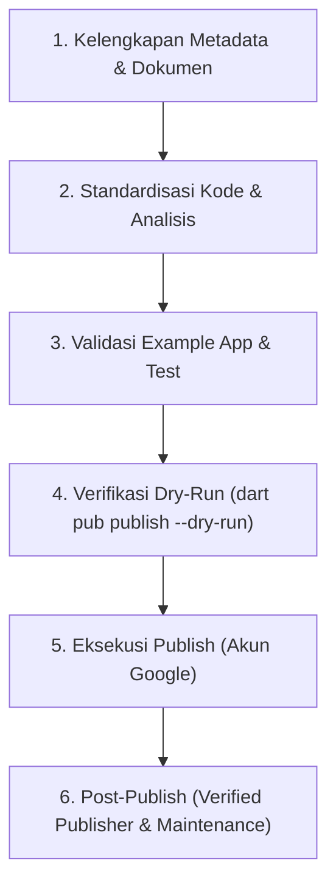

# 🚀 Roadmap & Checklist: Publikasi ke pub.dev

Dokumen ini berisi panduan terstruktur langkah demi langkah untuk mempublikasikan plugin **`flutter_face_recognition`** ke **[pub.dev](https://pub.dev)** dengan target skor maksimal (**140/140 Pub Points**).

---

## 1. Peta Alur Publikasi



---

## 2. Checklist Kriteria Pub Points (Target: 140/140)

pub.dev memiliki sistem penilaian otomatis (*Pana Analyzer*). Berikut komponen wajib yang harus dipenuhi:

### A. Metadata `pubspec.yaml`
- [ ] **`name`**: `flutter_face_recognition` (format snake_case, huruf kecil semua).
- [ ] **`description`**: Minimal 60–180 karakter, jelas menerangkan kegunaan plugin.
  > *Contoh:* `"A high-performance Flutter plugin for offline Face Recognition, Cosine Similarity matching, and Multi-Scale Passive Liveness Detection using TensorFlow Lite & ML Kit."`
- [ ] **`version`**: Mengikuti Semantic Versioning (`1.0.0`).
- [ ] **`homepage` / `repository`**: Tautan repositori GitHub publik (`https://github.com/Andrew-Hardianto/flutter_face_recognition`).
- [ ] **`issue_tracker`**: Tautan GitHub issues (`https://github.com/Andrew-Hardianto/flutter_face_recognition/issues`).
- [ ] **`topics`**: Maksimal 5 topik untuk mempermudah pencarian (misal: `face-recognition`, `tflite`, `liveness-detection`, `machine-learning`, `anti-spoofing`).
- [ ] **`environment`**: Menentukan batas versi SDK Dart dan Flutter yang kompatibel (misal: `sdk: '>=3.0.0 <4.0.0'`).

### B. Dokumentasi & File Legal
- [ ] **`LICENSE`**: File lisensi open source resmi (disarankan **MIT License**).
- [ ] **`README.md`**:
  - Ringkasan fitur utama (Face Detection, Liveness, Cosine Similarity).
  - Badge (pub version, likes, points, license).
  - Persyaratan platform minimum (Android minSdk 24, iOS 15.0+).
  - Contoh kode (*quickstart snippet*).
  - Penjelasan ambang batas (*thresholds configuration*).
- [ ] **`CHANGELOG.md`**: Riwayat perubahan terformat rapi sesuai versi (`## 1.0.0 - Initial release`).

### C. Folder `example/`
- [ ] Direktori `example/` harus berupa proyek Flutter mandiri yang dapat di-build dan dijalankan tanpa error.
- [ ] Terdapat `example/pubspec.yaml` yang merujuk ke plugin:
  ```yaml
  dependencies:
    flutter_face_recognition:
      path: ../
  ```

---

## 3. Langkah-Langkah Teknis Persiapan

### Tahap 1: Finalisasi Kode & Format Dart
1. **Format seluruh kode Dart**:
   ```bash
   dart format lib/ example/lib/
   ```
2. **Jalankan Static Analysis**:
   ```bash
   flutter analyze
   ```
   > ⚠️ *Penting*: Skor Pub Points akan berkurang jika ada warning/lint error atau `print()` tanpa logger.

### Tahap 2: Manajemen Ukuran Paket (< 100 MB)
1. Periksa ukuran file model TFLite:
   - `mobile_face_net.tflite` (~5 MB)
   - `anti_spoof.tflite` (~5.7 MB)
   Total ukuran sekitar ~11 MB (sangat aman di bawah limit 100 MB pub.dev).
2. Buat file `.pubignore` untuk mengecualikan file yang tidak perlu di-upload:
   ```gitignore
   .idea/
   .vscode/
   *.iml
   .DS_Store
   build/
   android/.gradle/
   ios/.symlinks/
   ```

### Tahap 3: Uji Coba Simulasi (`--dry-run`)
Sebelum benar-benar di-upload, jalankan perintah simulasi:
```bash
dart pub publish --dry-run
```
Perintah ini akan memeriksa:
* Apakah ada file yang hilang atau corrupt.
* Apakah format `pubspec.yaml`, `README.md`, dan `CHANGELOG.md` valid.
* Jika ada peringatan (*warnings*), perbaiki terlebih dahulu hingga menghasilkan:
  `Package has 0 warnings.`

---

## 4. Eksekusi Publikasi ke pub.dev

Setelah dry-run berhasil tanpa peringatan:

```bash
dart pub publish
```

1. Terminal akan menampilkan konfirmasi upload dan daftar file yang akan dikirim.
2. Ketik `y` untuk konfirmasi.
3. Terminal akan memunculkan URL autentikasi Google (OAuth).
4. Buka URL tersebut di browser, lalu login dengan akun Google Anda.
5. Setelah disetujui, terminal akan otomatis mengunggah package.
6. Package akan langsung live di:
   `https://pub.dev/packages/flutter_face_recognition`

---

## 5. Post-Publish: Menjadikan Verified Publisher (Opsional)

Untuk meningkatkan kredibilitas dan mendapatkan **Lencana Biru (Verified Publisher)**:
1. Masuk ke [pub.dev/create-publisher](https://pub.dev/create-publisher).
2. Masukkan domain web Anda (misal: `domainkamu.com`).
3. Verifikasi kepemilikan domain di **Google Search Console** (menggunakan DNS TXT record atau file HTML).
4. Setelah terverifikasi di Google, klik **Create Publisher** di pub.dev.
5. Pindahkan ownership package dari akun personal ke publisher tersebut via tab *Admin* di halaman package.

---

## 6. Checklist Eksekusi Bertahap

- [x] **Langkah 1**: Selesaikan implementasi plugin Flutter (`lib/`, `android/`, `ios/`).
- [x] **Langkah 2**: Siapkan `example/` app yang berfungsi penuh.
- [x] **Langkah 3**: Buat file `README.md`, `CHANGELOG.md`, dan `LICENSE`.
- [ ] **Langkah 4**: Push source code ke GitHub repository publik.
- [ ] **Langkah 5**: Jalankan `dart format .` dan `flutter analyze`.
- [ ] **Langkah 6**: Jalankan `dart pub publish --dry-run` sampai 0 warning.
- [ ] **Langkah 7**: Jalankan `dart pub publish`.
